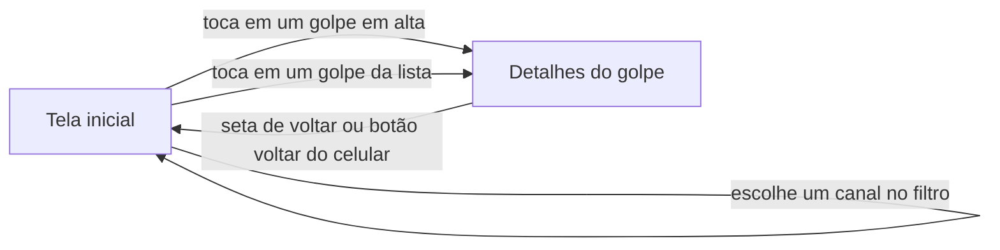
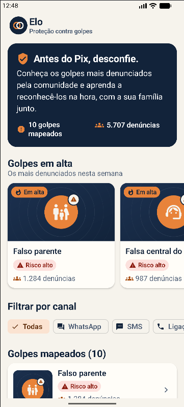
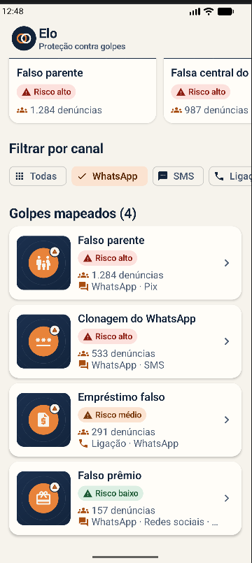
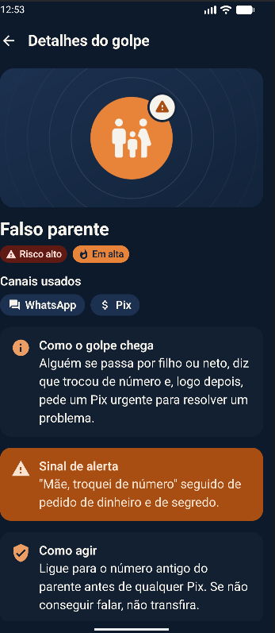
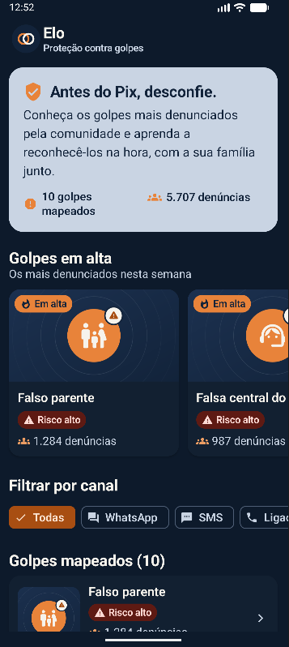

# Elo - Proteção contra golpes para idosos

Projeto da Global Solution 2026.2 da FIAP, curso de Sistemas de Informação, disciplina de Desenvolvimento de Aplicativos Android (Kotlin + Jetpack Compose).

Grupo: Squad Carbono

## Descrição da solução

O Elo nasceu de uma preocupação bem comum: quase todo mundo conhece algum idoso que já recebeu mensagem de "filho com número novo" pedindo Pix, ou ligação de uma suposta central do banco. A ideia do Elo é proteger essas pessoas **antes do Pix** e **com a família junto**. Na proposta completa da nossa GS, o Elo identifica mensagens suspeitas no celular do idoso e avisa um familiar (que chamamos de "guardião") quando percebe um possível golpe.

Para esta entrega de Android, desenvolvemos a **central de golpes do Elo**: um aplicativo que reúne os golpes mais denunciados pela comunidade e explica, com linguagem simples, como cada um funciona. Em cada golpe a pessoa vê por quais canais ele costuma chegar, qual o nível de risco, qual é o sinal de alerta e o que fazer na hora. A intenção é que o idoso e a família aprendam a reconhecer o golpe antes de cair nele.

Pensando no público, usamos textos um pouco maiores que o padrão, cores com bom contraste e um visual limpo, sem excesso de informação na tela.

## Tema da Global Solution

O tema da GS é **CitizenTech: tecnologia a serviço do cidadão**, e escolhemos trabalhar com golpes financeiros contra idosos porque os números são preocupantes:

- Em 2025, o Brasil registrou 2,26 milhões de estelionatos, um aumento de 430% desde 2018 (Fórum Brasileiro de Segurança Pública, 20º Anuário).
- Pessoas com 60 anos ou mais perdem, em média, 5 vezes mais dinheiro em golpes com Pix (Silverguard, com dados do Banco Central).
- Só 7,9% do valor perdido é devolvido integralmente pelo MED, o mecanismo de devolução do Pix.

Ou seja, depois que o dinheiro sai, é muito difícil recuperar. Por isso o foco do Elo é a prevenção. O projeto se relaciona com os ODS 10.2 (inclusão de todas as pessoas, independentemente da idade), 4 (educação) e 16.4 (combate aos fluxos financeiros ilícitos).

## Principais funcionalidades

**Resumo no topo da tela**
Logo que o app abre, aparece um card com a mensagem "Antes do Pix, desconfie.", o total de golpes mapeados e o total de denúncias da comunidade.

**Golpes em alta (lista horizontal)**
Uma lista horizontal (`LazyRow`) com os golpes que estão em destaque no momento. Cada card mostra a imagem do golpe, o título, o selo "Em alta", o nível de risco e o número de denúncias. Esses golpes não são cadastrados à parte: eles vêm da mesma lista de golpes do app, filtrados pelo atributo `emDestaque`.

**Filtro por canal (lista horizontal de categorias)**
Uma fileira de chips (`LazyRow` com `FilterChip`) com as opções Todas, WhatsApp, SMS, Ligação, E-mail, Pix e Redes sociais. Quando a pessoa toca em um canal, o chip fica destacado com um ✓ e a lista de golpes logo abaixo é atualizada na hora, mostrando só os golpes daquele canal. A opção "Todas" volta a mostrar os 10 golpes.

**Golpes mapeados (lista vertical)**
A lista principal (`LazyColumn`) com os 10 golpes cadastrados. Cada golpe aparece em um `Card` com imagem, título, nível de risco, número de denúncias e os canais por onde ele chega. O título da seção mostra quantos golpes estão aparecendo no filtro atual, por exemplo "Golpes mapeados (4)".

**Detalhes do golpe**
Tocando em qualquer golpe, seja da lista ou dos destaques, abre uma tela com tudo sobre ele: canais usados, como o golpe chega, o sinal de alerta (em destaque, para chamar atenção) e como agir. No final aparece quantas pessoas já denunciaram aquele golpe.

**Tema claro e escuro**
O app acompanha a configuração do celular e muda automaticamente entre o tema claro e o escuro, mantendo as cores do Elo (azul-marinho, laranja e creme).

## Fluxo de telas

O app tem duas telas, ligadas pelo Navigation Compose:



1. O usuário abre o app e cai na **tela inicial**, que tem, de cima para baixo: o resumo, os golpes em alta, o filtro por canal e a lista de golpes mapeados. Tudo rola junto, como uma página só.
2. Se ele escolher um canal no filtro, continua na mesma tela, mas a lista de golpes passa a mostrar apenas os golpes daquele canal.
3. Ao tocar em um golpe, vai para a **tela de detalhes**. O id do golpe é enviado pela rota `detalhe/{golpeId}`.
4. Pela seta no topo ou pelo botão voltar do celular, ele retorna para a tela inicial, e o filtro que estava escolhido continua selecionado.

## Prints das telas

| Tela inicial | Filtro "WhatsApp" aplicado | Detalhes do golpe | Tela inicial no tema escuro |
|---|---|---|---|
|  |  |  |  |

## Fonte dos dados

Os dados do app ficam **em memória**, dentro da classe `GolpeRepository` (pasta `data/repository`). Ela guarda uma lista de objetos `Golpe` e funciona como se fosse a base comunitária do Elo. Não usamos banco de dados nem API, então o app funciona totalmente offline.

Sobre o conteúdo:

- Os 10 golpes cadastrados são modalidades reais e muito comuns no Brasil: falso parente, falsa central do banco, falso INSS, loja falsa, clonagem do WhatsApp, mão fantasma, entrega pendente, empréstimo falso, boleto falso e falso prêmio. As descrições, os sinais de alerta e as orientações foram escritos pelo grupo a partir desses casos.
- Os **números de denúncias são fictícios**, criados só para a demonstração.
- As imagens dos golpes e o logotipo foram montados pelo grupo usando ícones do [Material Design Icons](https://github.com/google/material-design-icons), do Google (licença Apache 2.0), com as cores do Elo. Elas ficam em `res/drawable-nodpi`.

## Arquitetura e organização dos packages

Separamos o projeto por responsabilidade: modelos, dados, navegação e interface (telas, componentes e tema). Assim cada parte fica no seu lugar e fica mais fácil de entender e de manter.

```
app/src/main/java/br/com/fiap/elo/
├── MainActivity.kt                - abre o app, aplica o tema e chama a navegação
│
├── model/                         - modelos de dados
│   ├── Golpe.kt                   - data class que representa um golpe
│   ├── Categoria.kt               - enum class com os canais (categorias)
│   └── NivelRisco.kt              - enum class com os níveis de risco
│
├── data/repository/               - dados
│   └── GolpeRepository.kt         - lista de golpes em memória e funções de busca e filtro
│
├── navigation/                    - navegação entre as telas
│   ├── Routes.kt                  - rotas "home" e "detalhe/{golpeId}"
│   └── AppNavigation.kt           - NavHost com a tela inicial e a de detalhes
│
└── ui/
    ├── screens/                   - telas
    │   ├── HomeScreen.kt          - tela inicial
    │   └── GolpeDetailScreen.kt   - tela de detalhes do golpe
    │
    ├── components/                - componentes reutilizáveis (um por arquivo)
    │   ├── GolpeCard.kt           - item da lista principal
    │   ├── CategoriaSelector.kt   - fileira de categorias para filtrar
    │   ├── DestaqueCard.kt        - item da lista de destaques
    │   ├── DestaquesSection.kt    - lista horizontal dos destaques
    │   ├── NivelRiscoBadge.kt     - selo colorido do nível de risco
    │   ├── SeloEmAlta.kt          - selo "Em alta"
    │   ├── InfoLinha.kt           - ícone + informação curta (denúncias, canais)
    │   ├── InfoBloco.kt           - blocos de informação da tela de detalhes
    │   ├── CategoriaTag.kt        - etiqueta de canal usada nos detalhes
    │   ├── CategoriaIcone.kt      - ícone de cada categoria
    │   ├── SecaoTitulo.kt         - título das seções
    │   ├── ResumoCard.kt          - card de resumo do topo
    │   ├── EloTopBar.kt           - barra superior (logo ou seta de voltar)
    │   └── EloLogo.kt             - logotipo do Elo
    │
    └── theme/                     - Color.kt, Type.kt, Dimens.kt e Theme.kt
```

**Como as partes se conversam**

- **Modelos (`model`)**: o `Golpe` é uma `data class` com atributos tipados e construtor primário. Um golpe pode pertencer a mais de uma categoria, por isso usamos `categorias: List<Categoria>`. O atributo booleano `emDestaque` indica se ele aparece nos golpes em alta.
- **Repositório (`data/repository`)**: o `GolpeRepository` é o único lugar onde os golpes existem. Ele tem as funções `getGolpes()`, `getDestaques()`, `filtrarPorCategoria()`, `buscarPorId()` e `totalDenuncias()`. As duas telas usam a mesma instância do repositório, criada no `AppNavigation`.
- **Componentes (`ui/components`)**: só mostram as informações que recebem por parâmetro, e nenhum deles filtra dados. Os três componentes principais pedidos na atividade são o `GolpeCard` (item da lista), o `CategoriaSelector` (seleção de categorias) e o `DestaqueCard` (item de destaque). Todos têm `@Preview`.
- **Telas (`ui/screens`)**: a `HomeScreen` guarda qual categoria está selecionada, usando `rememberSaveable { mutableStateOf<Categoria?>(null) }`. Usamos `null` para representar a opção "Todas", já que "Todas" não é um canal de golpe e por isso não faz parte do enum.
- **Navegação (`navigation`)**: o `NavHost` controla a troca entre as telas e passa o id do golpe como argumento da rota.

**Como o filtro funciona na prática**

Quando o usuário toca, por exemplo, em "Pix":

1. O `CategoriaSelector` avisa a `HomeScreen` qual categoria foi escolhida, pelo `onCategoriaSelecionada`.
2. A `HomeScreen` atualiza o estado `categoriaSelecionada`.
3. Como o estado mudou, o Compose recompõe a tela.
4. A tela pede ao repositório `filtrarPorCategoria(Categoria.PIX)`, que devolve só os golpes que têm PIX na lista de categorias.
5. A `LazyColumn` mostra a lista nova, e o título passa a exibir "Golpes mapeados (3)".

## Desenvolvedores

| Nome completo | RM |
|---|---|
| Fernando Henrique Mendes da Silva | RM559838 |
| Pedro Chamusca de Mello | RM559632 |
| Cassia Emanuelly Dantas da Silva | RM561073 |
